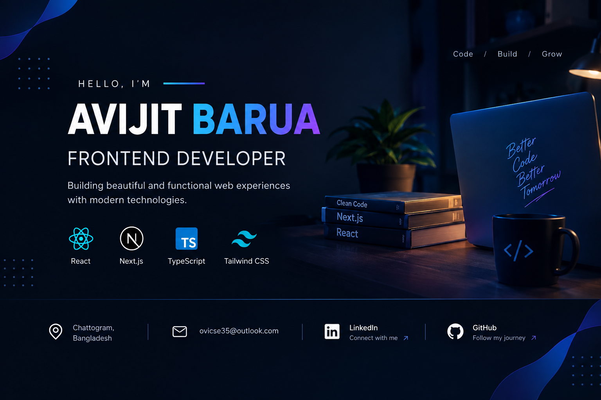

 <div align="center">



# Hi 👋, I'm Avijit Barua

### Frontend Developer | React • Next.js • TypeScript

<p>
  I enjoy building modern, responsive, and user-friendly web applications
  with clean UI and practical functionality.
</p>

</div>

---

## 👨‍💻 About Me

I'm a **Frontend Developer** focused on building modern web applications with React and Next.js.

- 🚀 Currently building projects with **React, Next.js & TypeScript**
- 🌱 Exploring modern frontend development and best practices
- 💻 Building responsive and user-friendly web applications
- 📚 Continuously improving my JavaScript and problem-solving skills
- 🎯 Working towards becoming a stronger full-stack developer

---

## 🛠️ Skills & Technologies

<div align="center">


<br><br>


</div>

---

## 🤝 Connect With Me

<div align="center">

<a href="mailto:ovicse35@outlook.com">
  
</a>

<a href="https://www.linkedin.com/in/avijit-barua-7a10691a8">
  
</a>

<a href="https://github.com/Avijit35cse">
  
</a>

</div>

---

## 📊 GitHub Stats

<div align="center">


<br><br>


<br><br>


</div>

---

## ⚡ Technologies I Work With

<div align="center">


<br><br>


</div>

---

## 🚀 Featured Projects

### 🏋️ FitLog — Workout Library

A modern dark-themed workout library built with **Next.js, TypeScript and Tailwind CSS**.

**Highlights:**

- 🏋️ Workout library with detailed exercise information
- 📋 Add workouts to today's plan
- 🔖 Save workouts for later
- 💾 LocalStorage persistence
- 🔍 Search and sorting functionality
- 📱 Responsive design for mobile, tablet and desktop
- 🔔 Toast notifications

**Tech Stack:** Next.js • TypeScript • Tailwind CSS • React • LocalStorage

[🌐 Live Demo](https://b14-a6-fit-log-opal-xi.vercel.app/) • [📂 GitHub Repository](https://github.com/Avijit35cse/B14-A6-Fit-Log)

---

### 🧑‍💻 Dev-Stack

A modern and responsive developer technology stack builder built with **React, TypeScript and Tailwind CSS**.

**Highlights:**

- 💻 Explore different frontend, backend, database, language, styling and DevOps technologies
- 🛠️ Build and manage your own personalized technology stack
- ⭐ View technology descriptions, ratings and difficulty levels
- 🔔 Toast notifications when adding or removing technologies
- 📱 Fully responsive design
- ⚡ Modern React-based application

**Tech Stack:** React • TypeScript • Tailwind CSS • DaisyUI • Vite • React Icons • React Toastify

[🌐 Live Demo](https://dev-stack-avijit.netlify.app/) • [📂 GitHub Repository](https://github.com/Avijit35cse/B14-A05-DevStack)

---

## 💡 What I'm Learning

```text
React
  ↓
Next.js
  ↓
TypeScript
  ↓
Advanced Frontend Development
  ↓
Full-Stack Development
```

---

### 🚀 Code • Build • Learn • Grow

**Thanks for visiting my profile!** ⭐
